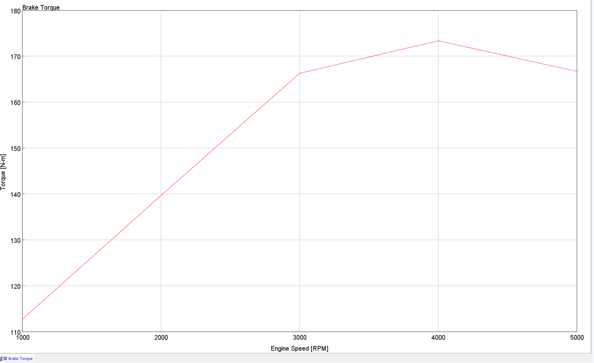
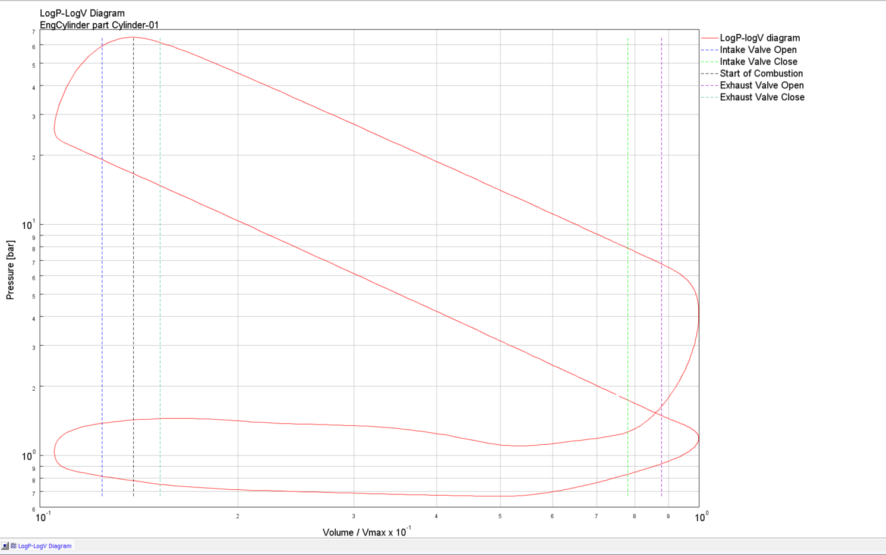
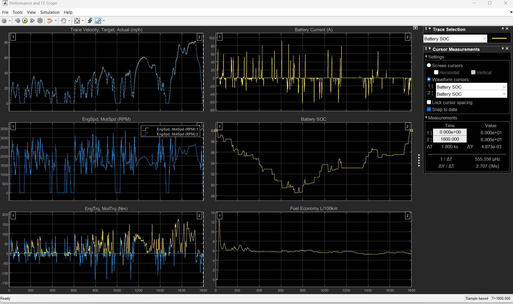
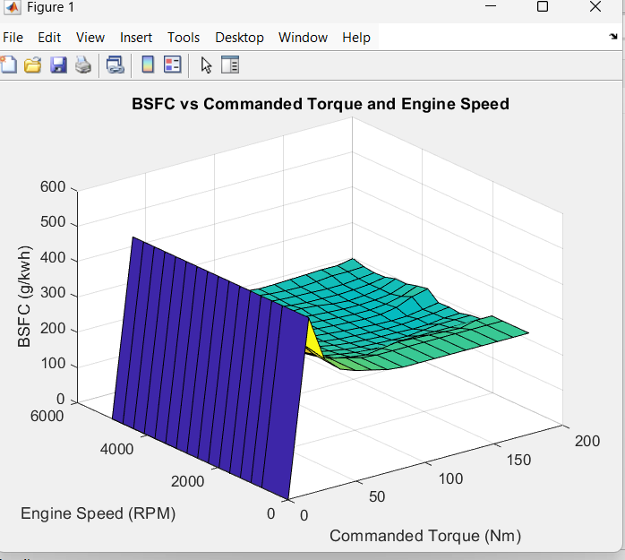

# 1D SI Engine Model (GT-Power) and ECMS-Controlled P1 Parallel Hybrid

Course project for *Power and Propulsion Systems for Unmanned Vehicles* (MSc Autonomous Vehicle Engineering, University of Naples Federico II, 2026). Individual project.

## Part 1: Engine modelling in GT-Power
- 1D model of a **four-cylinder port-fuel-injected spark-ignition engine** with scaled bore and stroke (`gt-power_models/`).
- Parameter sweeps over engine speed, air–fuel ratio, spark timing and throttle load.
- Characterised IMEP/BMEP, brake torque and power, volumetric efficiency, BSFC, and in-cylinder p–V and p–θ cycles.

| Brake torque vs. speed | p–V diagram |
|---|---|
|  |  |

## Part 2: P1 hybrid with ECMS
- Engine integrated into a **P1 parallel hybrid** governed by an **Equivalent Consumption Minimization Strategy**.
- Tuned a constant equivalence factor for charge-sustaining operation, implemented an **adaptive-EF** variant, and validated the calibration unchanged on **FTP-75**.
- Assessed state of charge, ICE/EM power split, fuel economy and tailpipe emissions (HC, CO, NOx, CO₂) against **Euro 6e** limits and the 2025 EU CO₂ target; ±25% vehicle-mass sensitivity study.

| WLTP performance | Operating points on the BSFC map |
|---|---|
|  |  |

Reports: [`docs/report_engine_gt-power.pdf`](docs/report_engine_gt-power.pdf) · [`docs/report_hybrid_ecms_simulink.pdf`](docs/report_hybrid_ecms_simulink.pdf)

## Notes
The `.gtm` models need a GT-SUITE licence. The Simulink hybrid-vehicle model is not included here; the full method and results are in the report.

## Author
Sadia Kabir Dina · [LinkedIn](https://www.linkedin.com/in/sadia-kabir-dina/)
